 Assignment 6 — jQuery Portfolio

Name: Zainab  
Group: 2501  
University:Astana IT University  
Subject: Web Development

 Project Description

This project is a personal portfolio website created using HTML, CSS, JavaScript, and jQuery. It demonstrates jQuery selectors, effects, DOM manipulation, attributes, form handling, and animations.

Technologies Used

- HTML
- CSS
- JavaScript
- jQuery 3.7.1

 Assignment Tasks

1. Setup: Added the jQuery library and document ready function.
2. Selectors and CSS: Used jQuery selectors to change text, styles, and themes.
3. Visibility Effects: Implemented Hide, Show, and Toggle.
4. Fade Effects: Used Fade In, Fade Out, and Fade Toggle.
5. Slide Effects: Used Slide Up, Slide Down, and Slide Toggle.
6. Add and Remove: Added, prepended, and removed technical skills.
7. Attributes: Changed a social media link using .attr().
8. Form: Created a live preview using .val() and .text().
9. Animation: Created animated skill progress bars using .animate().

 Screenshots

1. Setup and Selectors

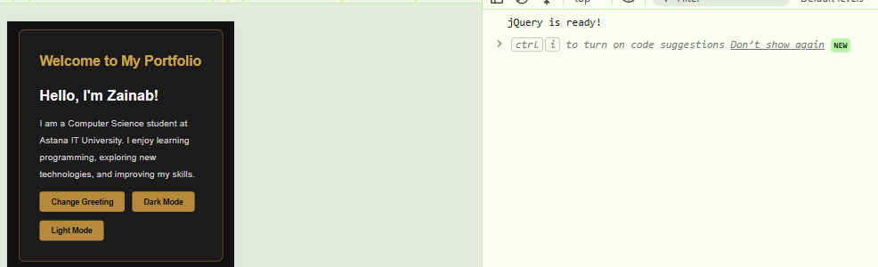

 2. Hide Effect

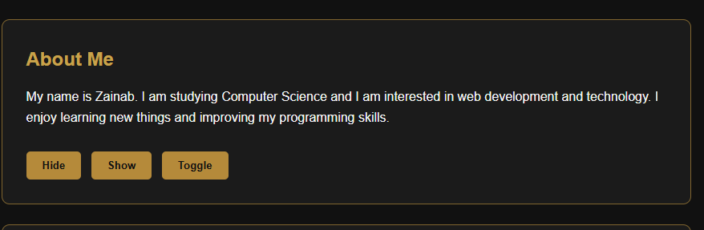

 3. Show Effect

 4. Fade Out

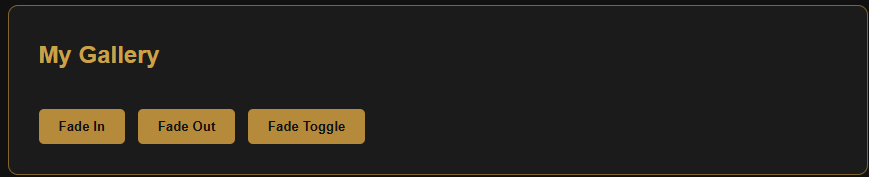

 5. Fade In

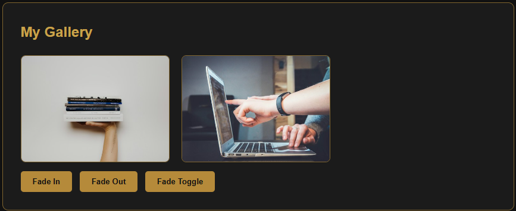

 6. Slide Down

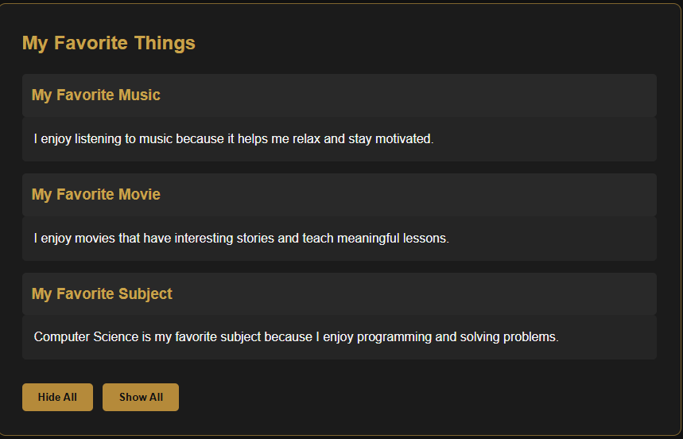

 7. Slide Up

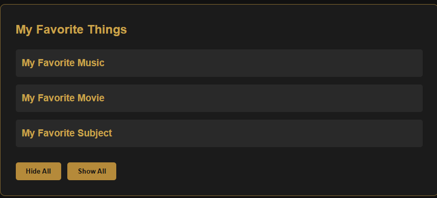

 8. Add Skill

 9. Prepend Skill

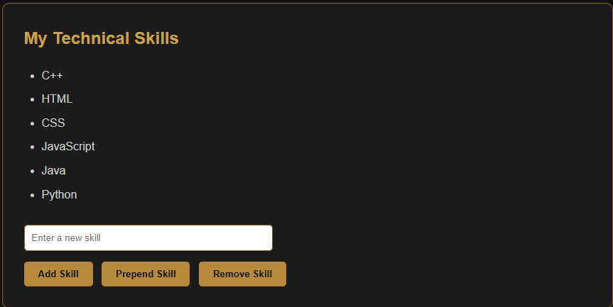

 10. Remove Skill

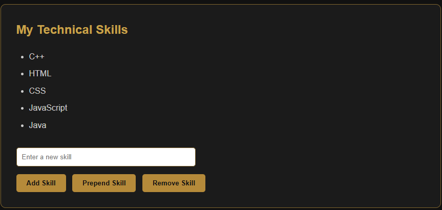

 11. Original Link

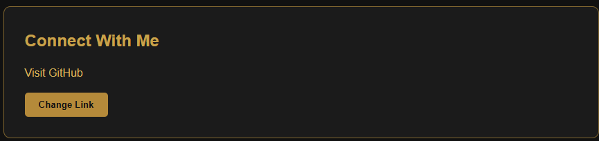

 12. Changed Link

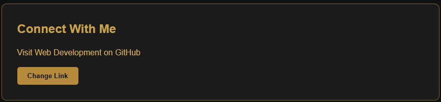

 13. Live Preview

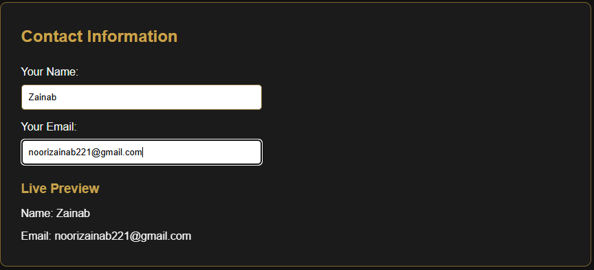

14. Skill Animation

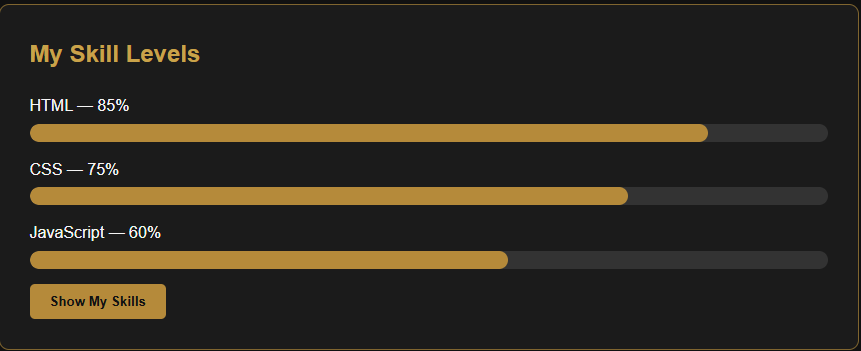

 Conclusion

Through this assignment, I practiced using jQuery to make a website interactive. I learned how to select HTML elements, change their content and styles, handle user events, manipulate elements, and create animations.
